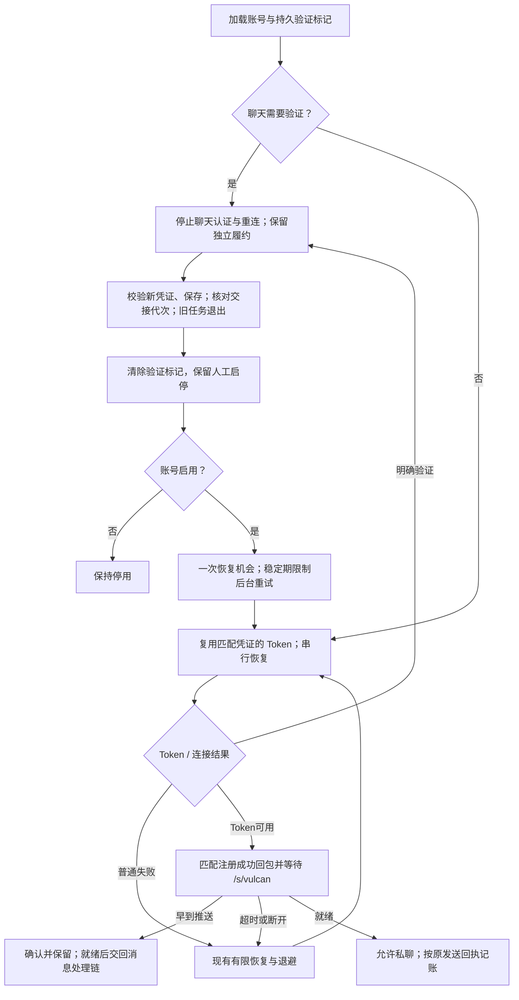

## Context

本地基线为 `be22c9d`，研究与源码证据沿用 [findings.md](findings.md)。用户已明确确认本规范并要求开始开发，服务器不可访问，本轮以本地 main 为代码依据。已存在账号恢复锁、实例刷新锁、扫码热切换、双通道履约与运行状态接口，按这些职责补齐即可。

本机服务进程早于当前源码，不能据此认定当前代码完全没有效果，也不能把更新源码视为运行实例已更新。运行核对和后续部署单独记录。

## Goals / Non-Goals

**Goals:** 减少同一验证事件下的重复认证；让有效扫码尽快恢复可聊；保留消息回执和履约独立记账；清楚表达需要验证、恢复中与可聊。

**Non-Goals:** 不保证平台不再触发验证；不实现自动绕过验证；不迁移开源框架，不引入 CookieCloud/Redis 或第二个凭证源；不修改批量推送、发货延迟、订单分配或历史补发宽限期。

## Decisions

### 1. 使用一个独立、持久的聊天验证标记

在现有 `cookies` 表增加 `chat_verification_required INTEGER NOT NULL DEFAULT 0`，通过现有迁移模式和账号查询加载。它只表示“聊天认证等待人工完成验证”，不复用全账号 `enabled` 或用户状态文案。原因、时间与恢复记录继续写现有风险日志，不新增事件表。

只有平台明确要求安全验证时置位，例如 `FAIL_SYS_USER_VALIDATE`、真实验证链接和现有 hard-block 判断命中；`captcha_recovery_disabled` 所对应的已确认验证也必须置位。普通 Token/Session 过期、网络错误和聊天就绪超时不直接置位。

标记置位后，该账号的聊天 Token、聊天登录兜底、聊天保活与 WS 自动重连均停止产生新请求；关闭聊天连接及其心跳。保留账号实例和独立 HTTP 履约职责，其他账号继续运行。原有针对真正账号风险的全账号保护继续有效。

选择独立标记是因为仅扩大 `_is_account_pause_status` 会把聊天验证与全账号停用混在一起；只延长内存退避则会在到期或进程重启后自动重试。

### 2. 复用账号交接与刷新锁

复用 `XianyuLive` 的账号认证恢复锁、`refresh_token` 锁以及 `CookieManager.update_cookie` 的串行切换。所有聊天恢复入口先检查同一个标记，同账号同一时刻只有一个恢复流程；不新增独立刷新调度器。

有效凭证交接采用现有扫码/手工 Cookie 更新入口：确认账号归属与已有完整性检查通过，保存凭证，等待旧任务退出，重置旧连接就绪状态，再清除聊天验证标记并唤醒一次恢复。重复轮询同一扫码 session 不重复提供恢复机会。手工停用的账号仍保持停用。

恢复中的响应在回写前必须确认仍属于当前活动实例与其凭证。旧实例的迟到错误不能重新设置新实例的暂停状态；旧实例的成功也不能解除新的验证状态。实现复用实例生命周期，补充进程内交接代次与 Cookie 条件写回；正常 Cookie 轮换在认证前从现有数据库同步，不新增持久化凭证副本。暂停置位与交接代次在同一认证锁内核对。手动停用账号在交接完成后持久清除旧验证标记，但不启动聊天。

### 3. 扫码稳定期限制后台扰动，不挡住一次受控恢复

保留现有稳定期机制用于抑制后台重复认证，不把全局 15 分钟常量直接归零。完整扫码交接后允许一次受控 Token/连接恢复，复用已获得的有效 Token；失败按普通过期、网络错误或明确验证分别处理。

禁止因稳定期而将这一次恢复推迟 15 分钟。单次聊天初始化使用有界超时，目标 30 秒内得到“可聊”或明确失败/验证状态；该上限从有效 Cookie 交接完成算起，不包含用户扫码时间，也不是平台可用性承诺。

### 4. 连接注册和聊天就绪分开

在当前 `init` 中处理匹配注册 mid 的成功回包，并确认业务就绪信号后才设置 CONNECTED/`ws_ready`。本轮参考实现采用 `/s/vulcan`；实施前先复核已有脱敏握手样本，若实际合法序列不同，先修订本规范，不降级为“连接建立即成功”。

初始化阶段由 `init` 单独读 socket，完成后交还主接收循环，避免两个消费者同时 `recv`。初始化期间到达的合法推送按现有 ACK/队列逻辑保留并交给主处理链，不能为等就绪而丢弃消息。超时或断开清除就绪状态，不能将普通超时判成风控。

普通发信和恢复后的私信补发必须检查同一就绪状态。沿用按消息 mid 匹配的发送 ACK；无确定回执不标送达，不因恢复重新分配卡密。扫码稳定期与私信缺口的 900 秒防重复宽限是两件事，后者本次保持。

### 5. 普通客服夜间回复回到秒级

白天 2–10 秒行为保持；工作区默认夜间回复区间改为 2–10 秒，并同步代码 fallback。就绪状态不满足时不能靠缩短等待强行发送。其他部署的显式运营配置不自动覆盖；发货延迟和夜间保活倍率不调整。

### 6. 运行信息和验证复用现有入口

使用进程启动时间、启动来源、工作目录或部署镜像、有效配置与已有账号运行状态核对目标实例。`/health` 成功只证明基本服务可用，不能证明当前代码已加载或聊天可用；本次不另建诊断平台。

现有账号运行状态响应增加聊天验证标记，并将 `ws_ready` 改为真实注册/业务就绪结果。现有展示优先复用状态文案，避免面板显示在线而实际不可聊。

### 流程图

独立发货凭证链继续按原有状态和规则执行，不以聊天验证标记作为全账号停用依据。

## Risks / Trade-offs

- 平台仍可能要求验证 → 本次承诺停止重复扰动和清晰恢复，不把减少风控写成已验证效果。
- 错把普通错误识别成验证会造成不必要停聊 → 分类只依据明确平台响应，复用现有风险日志保留原因。
- 初始化等待可能截走早到推送 → 保持单一 socket 读取者，保留现有消息处理与 ACK 路由。
- 旧进程或旧代码回滚不认识新标记 → 部署前核准实例；回滚时保持受限账号人工暂停，不让旧版本在该账号上自动恢复。
- 夜间回复变快的长期影响尚无账号证据 → 对照同账号既有记录连续观察，不宣称秒级延迟能避免风控。

## Migration Plan

1. 提案明确确认后进入 apply，先复核基线与现有验证入口，再按 `task_plan.md` 实现。
2. 新字段按项目现有幂等迁移添加，旧账号默认 0；不根据历史日志批量给账号设限，不改变已有启停或订单数据。
3. 复用已有隔离回归，另用脱敏样本和授权测试会话验证；不生成测试代码。实际实例核对、重启/部署及真实发信分别按当时授权执行。
4. 目标实例切换前记录版本和配置并保留数据库备份；切换后核对保护状态及端到端回执。代码回滚可保留新增列，不做删除列迁移。
5. 至少连续 72 小时观察扫码/验证次数、Token 请求、聊天可用时长和回复延迟；观察窗口未完成时保留为待验收，不提前 archive。没有足够自然消息样本则如实记录证据不足。

## Open Questions

- 用户已说明平台位于不可访问的服务器，按本地 main 开发。运行版本、部署及服务器配置由后续可访问环境核准，本机 8090 不作为生产证据。
- 同次受限时官方电脑网页版能否正常发消息，尚未确认。只有确认可用后，才另行界定常驻浏览器试验；本次不预先实现它。
- 已复核固定版本 CLI 的 wait_ready 与正常序列 fixture，候选协议一致；当前账号的现场握手仍待部署联调，不能把 fixture 当作本账号实测。
